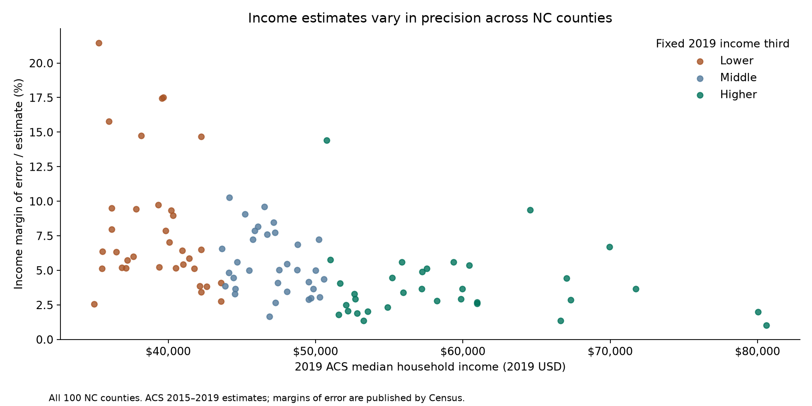
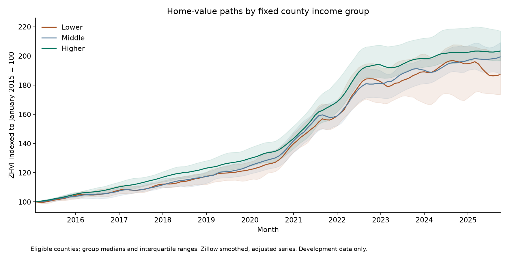
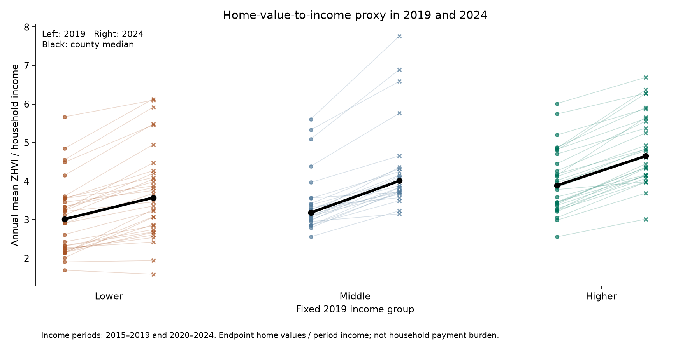
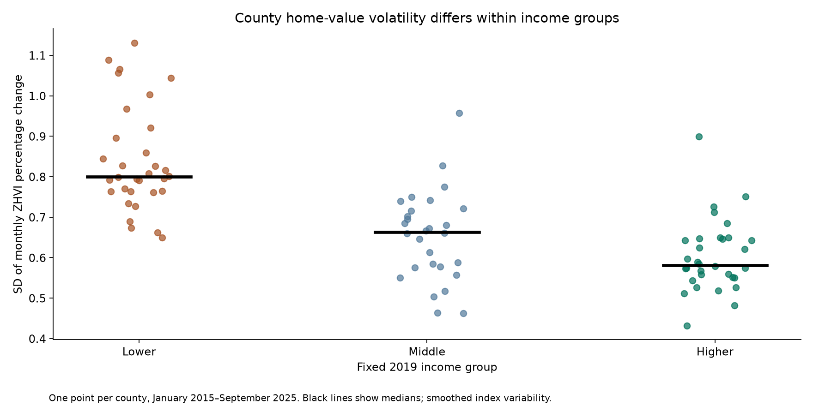
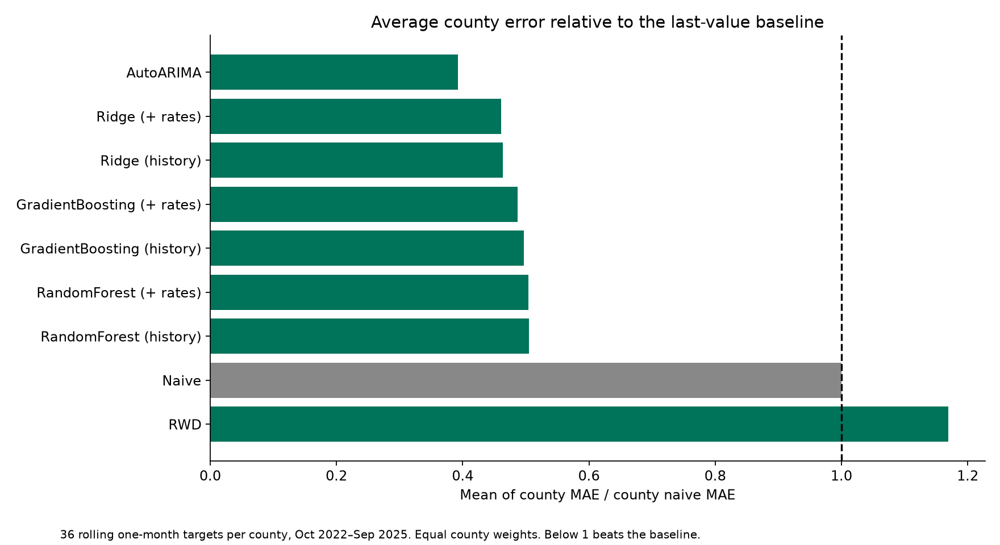

# Housing affordability and one-month home-value forecasts in North Carolina

Neelesh Reddi and Anirudh Ramesh • UNC Charlotte • DTSC 2302 Modeling and Society • November 19, 2026

## 1. Introduction and research question

How has housing affordability (home values relative to household income) changed across North Carolina areas over time, and does a forecasting model using past home values and mortgage rates predict home values equally well in lower-income and higher-income areas?

We operationalize “area” as a county. The descriptive portion compares two income periods. The regression portion predicts the next monthly value of Zillow’s county home-value index. The unit of evaluation is a county observed over time. Each county receives equal weight so that a large market cannot determine the statewide summary by population size alone.

The median county home-value-to-income ratio increased in all three income groups between the 2019 and 2024 comparisons. During the reserved test year, Ridge with mortgage rates had a mean county absolute percentage error of 0.251% in the lower-income group and 0.082% in the higher-income group. The average dollar error also differed, at $430 versus $298. These are differences in the accuracy of a one-month forecast of a smoothed index. Their relevance to an individual home, a household budget, or a longer-term decision requires separate evidence.

<!--page-->

## 2. Background, research, and social context

Housing affordability depends on the resources a household has left after paying for shelter. Stone (2006) develops that residual-income perspective. Our county ratio measures a narrower question that public data can answer consistently. If a typical home increases from three to four times annual median income, its value has risen relative to local resources. The ratio alone cannot distinguish changes in down-payment difficulty from changes in monthly mortgage costs. Knoll, Schularick, and Steger (2017) document long-run changes in house prices across advanced economies. Their much longer time scale illustrates why a price trend and a one-month forecast answer different questions.

Measurement also affects apparent predictability. Case and Shiller (1989) studied repeat sales in four U.S. cities. Their research found some persistence in city-level price changes alongside substantial variation in individual homes. Our interpretation is that the choice of prediction target matters: the history of a county index can be informative even when that index supplies little guidance about a particular sale. Zillow smoothing may itself create predictable short-term movements.

Shi (2011) found that interest rates, rents, and local prices shared a long-run relationship in New Zealand and that adjustment varied across markets. A national mortgage rate may carry useful time information for all NC counties while leaving much of their individual movement unexplained. We test its incremental contribution by keeping Ridge’s inputs and settings identical except for the two rate variables. This design answers whether the variables improved forecasts for these counties and months. It cannot isolate what would have happened to prices under a different monetary policy.

<!--page-->

### Geographic variation, methods, and the decision to compare errors

Bork and Møller (2015) compare house-price forecasting specifications across the 50 U.S. states and allow models to change over time. Jadevicius and Huston (2015) examine a univariate ARIMA approach for Lithuania. Dufitinema (2022) compares time-series methods for returns and volatility in Finnish housing markets. Together these studies motivate a local history-based benchmark and evaluation over time. Their targets, geographies, and frequencies differ from ours. The North Carolina data must determine which approach works for the county-index forecast.

We include the tree ensembles described by Breiman (2001) and Friedman (2001) to test whether a flexible mapping from prior changes and rates improves forecasts. A stronger fit to historical prices alone would supply little reason to adopt a model. Hyndman and Koehler (2006) explain why accuracy measures can yield different comparisons across series and propose MASE. We therefore report dollar, percentage, and benchmark-relative errors. Our relative measure divides by the naive error on the same evaluation dates. Its denominator differs from the training-period scaling used for MASE.

A planner may use forecasts to decide which counties merit closer investigation. Residents may be affected by that allocation even if they never see a prediction. The cost of a mistaken forecast depends on the decision and the resources at stake. Selbst et al. (2019) discuss how fairness analyses can lose social context through abstraction. Reporting income-group errors makes a particular reliability difference visible. Evaluating the fairness of an actual decision would also require knowing who used the forecast and what else informed the decision.

<!--page-->

## 3. Dataset, measurement, and provenance

The November 1 snapshot combines Zillow Research’s monthly, smoothed, seasonally adjusted, middle-tier county Home Value Index, Freddie Mac’s national weekly 30-year fixed mortgage rate through FRED, and U.S. Census Bureau American Community Survey five-year household income estimates (table B19013). The raw-file manifest records provider URLs, retrieval times, and SHA-256 hashes. Data Provided by Zillow Group.

A development observation has five fields: county FIPS, month end, ZHVI in dollars, the prior month’s average mortgage rate in percentage points, and the change in that rate from the month before. County identifiers retain their geographic meaning and serve as series keys. We average weekly rates within each calendar month before calculating lags. A given month’s national rate is identical across counties. Freddie Mac changed its survey methodology in November 2022, which limits the interpretation of changes around that date.

We screened all 100 NC counties using development-period data. Ninety-two had 129 complete positive monthly values from January 2015 through September 2025. That produced 11,868 rows. The eight excluded counties were Alamance, Avery, Burke, Chowan, McDowell, Robeson, Stanly, and Watauga. The reserved year contained all 1,104 expected targets for the original 92 counties. Using a common record gives each model the same forecasting dates but limits the population to counties with sufficient coverage.

Income groups were fixed using all 100 counties’ 2019 estimates before filtering on housing coverage. The lower and upper thresholds were $43,597 and $50,558. Exact ties went to the lower group. The eligible sample comprised 32 lower-, 28 middle-, and 32 higher-income counties. A household living in one of these counties can have an income far above or below its county median.

<!--page-->

## 4. Exploratory data analysis

Figure 1 shows variation in the precision of the 2019 ACS income estimates across counties. Forty eligible counties have an income estimate plus or minus its published margin of error that crosses at least one fixed group boundary. This finding changes how we interpret a group comparison. We repeat the comparison in the subset of counties whose intervals stay within a group and report how many remain.

The development panel’s home-value observations have a median of $185,296, a mean of $206,184, and an interquartile range of $131,217 to $256,400. Those figures describe county-month observations over almost eleven years. The larger mean is consistent with a high-value tail. A high value may identify an expensive market or a later point in its history. Automatically removing it would change the price distribution that the model is intended to predict.

The lagged national mortgage rate ranged from 2.684% to 7.620%, with a median of 4.033%. A panel with nearly twelve thousand rows still contains only 129 distinct monthly dates in development. Repeating a national series across counties creates no additional independent observations of a national rate shock.

<!--page-->

### Home-value paths and affordability

Each county starts at 100 in January 2015. By September 2025 the group medians were approximately 187 for lower-income counties, 199 for the middle group, and 203 for the higher group. The shaded regions capture the middle half of county paths. Common growth makes a random split across dates inappropriate: observations near the end of the series could otherwise inform predictions for earlier months.

The median county ratio increased from 3.01 to 3.57 in the lower group, 3.18 to 4.00 in the middle group, and 3.88 to 4.65 in the higher group. Each ratio uses mean ZHVI in the endpoint year divided by the corresponding five-year income estimate in end-year dollars. These are comparisons of 2019 with 2024. They do not identify the month when affordability changed or the number of households priced out of buying.

<!--page-->

### Variation within groups

Each dot is one county’s standard deviation of monthly percentage changes. Differences within a group matter because an average error can hide counties that are much harder to forecast. We retain all eligible counties and report the county scores so a reader can examine that variation directly. Smoothing affects the apparent size of the monthly movements. The dispersion concerns the published ZHVI series.

The four exploratory figures guided three design choices. We preserve time order when comparing models because housing values trend over time. We compare against a local last-value baseline because counties differ in prices and persistence. We also report percentage error alongside dollars because a $500 miss on a $100,000 index represents a larger proportional error than a $500 miss on a $500,000 index. This final choice matters empirically: a percentage gap across income groups could partly reflect the different price denominators. Examining dollars separately provides a check.

<!--page-->

## 5. Data preparation and modeling strategy

We reshaped Zillow’s monthly columns into chronological county series and joined the rate data by month. Eligibility and income-group boundaries were set using development information. We kept the published housing series and excluded incomplete development histories. We used income only for the affordability and error comparisons. The model receives past prices and, in designated configurations, past mortgage-rate information.

The naive baseline repeats the latest observed value. A drift benchmark extends a county’s average historical change. Nonseasonal AutoARIMA selects a time-series specification within each county’s training window. We used a nonseasonal specification because the published series is seasonally adjusted. These statistical approaches have access to each county’s own training history.

The machine-learning models pool counties. Within each training window we first difference the target and standardize within county. Each model receives transformed history at lags 1, 2, 3, 6, and 12. The rate versions receive the prior monthly rate and its prior change. Nixtla MLForecast inverts the target transformations to return predictions in dollars. Ridge uses standardized inputs and a penalty of 1. The random forest uses 200 trees, maximum depth 6, and a minimum of 5 observations in each leaf. Histogram gradient boosting uses 150 iterations, up to 10 leaves, L2 regularization of 1, and no random early-stopping split. Pooled models can learn from other counties’ training records, which distinguishes their information set from AutoARIMA’s.

<!--page-->

### Time ordering and independent evaluation

Development validation used one-month predictions for October 2022 through September 2025. At every cutoff we refitted the model and transformations on earlier observations. Each configuration produced 36 predictions for each of the 92 counties. Comparing versions with and without rates on the same county-months isolates the change in the predictive specification. It does not identify a causal rate effect.

We selected the primary rate-inclusive model using the equal-county average of each model’s mean absolute error divided by its county’s naive mean absolute error. Relative MAE below one indicates smaller average benchmark-relative error. We also report average county MAE, RMSE, MAPE, and signed error, with positive signed errors indicating overprediction. RMSE is calculated within county before averaging counties. A population-weighted analysis could answer a different question about how many people experience an error.

Before accessing reserved outcomes, we recorded the models and metrics in Git commit a3efaa0. We selected Ridge with rates as primary, history-only Ridge to test the contribution of rates, the naive baseline, and AutoARIMA as the overall development winner. The final year comprises twelve successive one-month predictions. An October observation can enter training for November after October has passed. October cannot enter training for its own forecast. We fixed all model settings in advance and made no adjustments based on the final scores.

<!--page-->

## 6. Model evaluation and comparison

During development, relative MAE was 0.461 for Ridge with rates, 0.487 for boosting with rates, and 0.504 for the forest with rates. Their history-only versions scored 0.464, 0.497, and 0.505, respectively. AutoARIMA scored 0.393 and drift scored 1.169. The rate-inclusive Ridge was the strongest model directly addressing the mortgage-rate question. AutoARIMA offered a strong comparator that used only county housing history.

**Final one-month forecasts, October 2025 through September 2026. All metrics average counties equally.**

Model | MAE ($) | RMSE ($) | MAPE (%) | Relative MAE
---|---:|---:|---:|---:
Repeat last value | 719.59 | 849.73 | 0.3012 | 1.000
Ridge, history only | 367.87 | 447.71 | 0.1563 | 0.584
Ridge, history and rates | 360.47 | 442.20 | 0.1562 | 0.565
AutoARIMA | 315.87 | 389.04 | 0.1342 | 0.499

Ridge with rates beat the naive model in 88 of 92 counties on dollar MAE. Adding rates to Ridge lowered the average county MAE by $7.40. The difference in average percentage error was less than 0.001 percentage point. The size of the gain depends on the metric and is small compared with the improvement from using housing history beyond the last value.

<!--page-->

## 7. Interpretation and findings

Fixed 2019 income group | Counties | Ridge MAE ($) | RMSE ($) | MAPE (%) | Signed error ($)
---|---:|---:|---:|---:|---:
Lower | 32 | 429.66 | 519.77 | 0.2512 | -93.09
Middle | 28 | 352.88 | 440.13 | 0.1325 | -9.57
Higher | 32 | 297.93 | 366.45 | 0.0821 | 85.28

Over the reserved year, Ridge with rates had a lower-minus-higher gap of $131.74 in mean county MAE and 0.169 percentage point in MAPE. The lower group had higher average percentage errors in every one of the twelve months. The largest lower-group monthly mean was 0.406% in March 2026. The higher group averaged 0.077% that month. Although the full sample had little net signed error (about -$6), the group means went in opposite directions. An aggregate signed error would hide that pattern.

The sensitivity check removes counties whose ACS income interval crosses an income-group threshold. It retains 19 lower, 4 middle, and 29 higher counties. Lower and higher MAPE were 0.278% and 0.069%, respectively. The direction persists for this selected subset, though its composition changes substantially. Common economic shocks and repeated observations make a calculation that treats every county-month as independent unsuitable for a significance claim.

The final development-only Ridge interpretation fit gave the largest absolute standardized coefficients to changes one and two months ago (+1.38 and -0.55). The two rate coefficients had smaller magnitudes (approximately -0.10 and +0.08). Since recent changes are correlated, coefficients are conditional on the other predictors. The held-out comparison that removes the rate inputs gives a more direct assessment of their incremental predictive value.

<!--page-->

## 8. Modeling and society

A county planner might compare recent growth across areas when deciding where to investigate housing pressure. If a forecast consistently understates growth in a lower-income county, a planner might give that county less attention than its residents need. This is a plausible consequence of using the model. Our study observed errors, not actual allocation decisions. Even a perfectly accurate home-value forecast would omit rents, financing costs, housing supply and the household budgets needed to choose an intervention.

The test-year gap warrants reporting in both percentage and dollar terms. Lower prices can produce larger percentages for a given dollar miss. Here the lower group also had larger absolute dollar errors. Possible explanations include local volatility, differences in the underlying information available to Zillow, and the way shared predictors perform across markets. Our national interest-rate series contains no cross-county variation within a month. Identifying which mechanism explains the difference would require evidence on local markets and measurement processes.

Requiring a complete history excludes eight counties. Allocating resources from this sample as though it represented every county could leave those places without evidence or give a more complete market undue weight. Fixed 2019 groups support a consistent comparison over time, but household circumstances within each county can change. No individual records are required for this analysis. Use in decisions about a borrower, tenant, or individual property goes beyond the evidence available at county level.

Deployment for lending, purchasing, or resource allocation is unjustified on the present evidence. A research use is to identify counties for closer local review. Before any operational use, prospective tests would have to use the data actually available on each forecast date, measure uncertainty and monitor errors by group over new market conditions. A local user would also need a process for correcting stale or unrepresentative inputs.

<!--page-->

## 9. Conclusion

Home values increased relative to median household income between the two observed endpoints in every fixed income group. The higher-income counties had the largest median ratio in both years. That observation does not rank individual households by their ability to purchase a home. A ratio based on county medians and typical values leaves substantial variation within counties unmeasured.

The primary rate-inclusive model predicted the next month’s county index substantially more accurately than repeating the latest value. Adding national mortgage information improved Ridge’s average dollar error modestly. AutoARIMA achieved the lowest overall test error using only county histories. Across income groups, the primary model was less accurate for lower-income counties in both dollars and percentages. The one-year test reproduced the direction observed during development.

These conclusions apply to one-month predictions of a revised and smoothed series for the 92 eligible counties. The November 2026 data vintage may include revisions to earlier observations, and the experiment did not reconstruct historical release calendars. Strong retrospective accuracy can therefore overstate real-time performance. Twelve forecasts per county also represent one market year. Longer horizons would require separate evaluation and an explicit assumption about future rate information.

## 10. References and technical appendix

The journal and conference references on the following pages support the draft literature discussion. Claims are based on publication records, abstracts, or author research summaries as documented in the project. Verification against UNC Charlotte’s Atkins collection and review of the relevant passages by the students are pending confirmation.

<!--page-->

### References

Bork, L., & Møller, S. V. (2015). Forecasting house prices in the 50 states using dynamic model averaging and dynamic model selection. International Journal of Forecasting, 31(1), 63–78. https://doi.org/10.1016/j.ijforecast.2014.05.005

Breiman, L. (2001). Random forests. Machine Learning, 45, 5–32. https://doi.org/10.1023/A:1010933404324

Case, K. E., & Shiller, R. J. (1989). The efficiency of the market for single-family homes. American Economic Review, 79(1), 125–137. Author working-paper record and journal publication details: https://www.nber.org/papers/w2506

Dufitinema, J. (2022). Forecasting the Finnish house price returns and volatility: A comparison of time series models. International Journal of Housing Markets and Analysis, 15(1), 165–187. https://doi.org/10.1108/IJHMA-12-2020-0145

Friedman, J. H. (2001). Greedy function approximation: A gradient boosting machine. The Annals of Statistics, 29(5), 1189–1232. https://doi.org/10.1214/aos/1013203451

Hyndman, R. J., & Koehler, A. B. (2006). Another look at measures of forecast accuracy. International Journal of Forecasting, 22(4), 679–688. https://doi.org/10.1016/j.ijforecast.2006.03.001

Jadevicius, A., & Huston, S. (2015). ARIMA modelling of Lithuanian house price index. International Journal of Housing Markets and Analysis, 8(1), 135–147. https://doi.org/10.1108/IJHMA-04-2014-0010

Knoll, K., Schularick, M., & Steger, T. (2017). No price like home: Global house prices, 1870–2012. American Economic Review, 107(2), 331–353. https://doi.org/10.1257/aer.20150501

<!--page-->

### References and data sources

Selbst, A. D., boyd, d., Friedler, S. A., Venkatasubramanian, S., & Vertesi, J. (2019). Fairness and abstraction in sociotechnical systems. Proceedings of the Conference on Fairness, Accountability, and Transparency, 59–68. https://doi.org/10.1145/3287560.3287598

Shi, S. (2011). Mortgage interest rates, rents, and local house price movements in New Zealand. Journal of Real Estate Portfolio Management, 17(1), 53–68. https://doi.org/10.1080/10835547.2011.12089890

Stone, M. E. (2006). What is housing affordability? The case for the residual income approach. Housing Policy Debate, 17(1), 151–184. https://doi.org/10.1080/10511482.2006.9521564

Freddie Mac. (n.d.). 30-year fixed rate mortgage average in the United States [MORTGAGE30US, data set]. Federal Reserve Bank of St. Louis. Retrieved November 1, 2026, from https://fred.stlouisfed.org/series/MORTGAGE30US

U.S. Census Bureau. (n.d.). American Community Survey five-year estimates, table B19013 [Data sets, 2015–2024 releases]. November 1, 2026 snapshot. https://api.census.gov/data/2024/acs/acs5/groups/B19013.html

Zillow Research. (n.d.). Zillow Home Value Index, middle-tier all homes, smoothed and seasonally adjusted county series [Data set]. Retrieved November 1, 2026, from https://www.zillow.com/research/data/

Nixtla. (n.d.). MLForecast and StatsForecast [Software]. The project pins the tested versions in requirements-lock.txt. https://nixtlaverse.nixtla.io/mlforecast/ and https://nixtlaverse.nixtla.io/statsforecast/

<!--page-->

### Technical appendix, AI assistance and contribution review

The repository contains executable Python scripts, the pinned dependency list, the pre-evaluation protocol, and the published error records. Repository branch: https://github.com/nreddi2/housingpredictability/tree/codex/forecasting-pilot

To reproduce final scores without downloading data, install the pinned environment and run scripts/summarize_final.py. The input contains 4,416 model, county and month records: four predictions for each of 92 counties and 12 dates. Signed error is forecast minus observed index in dollars. APE is absolute error divided by the observed index, multiplied by 100. The script calculates each county score, then averages counties by income group and overall. The results/final directory includes monthly group summaries and the sensitivity analysis.

To refit from the original source bytes, place the November 1 raw snapshots listed in data/raw/pilot_download_manifest.json in data/raw. The group’s local archive contains those files. Live provider data can change. The script verifies hashes before fitting. Run scripts/run_panel.py, scripts/verify_panel.py, scripts/interpret_panel.py, and scripts/run_final.py in the pinned Python 3.12 environment. Local prediction files contain cutoff dates, targets, and forecasts. Shared results contain derived errors and analysis summaries. Review the repository README for commands.

OpenAI Codex helped implement and execute the analysis, verify data and metrics, create figures, and draft report text. The assistance log records tasks and verification limits. The students should confirm that the final disclosure meets their instructor’s AI policy.

Contribution record for review: Neelesh selected the research question, coordinated project development, and requested revisions to clarify model choices and chart labels. Both Neelesh and Anirudh took part in presentation practice. The worksheets assigned Neelesh the forecasting review and Anirudh the data and measurement review. Completion of those assignments and joint review of the full report must be recorded by the students before submission.
